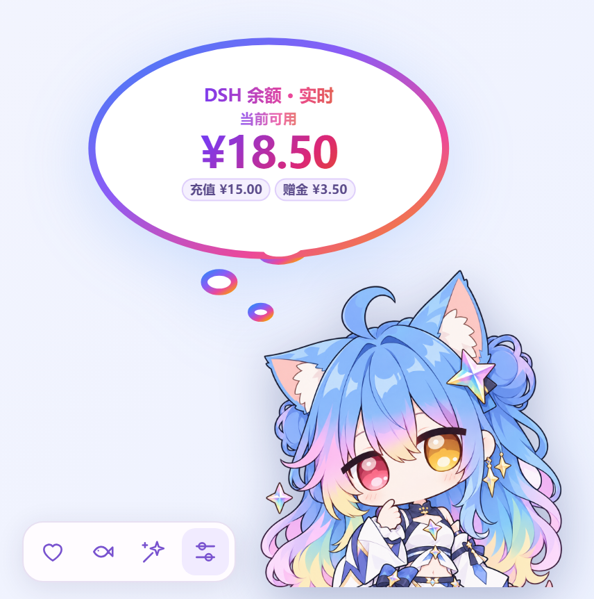
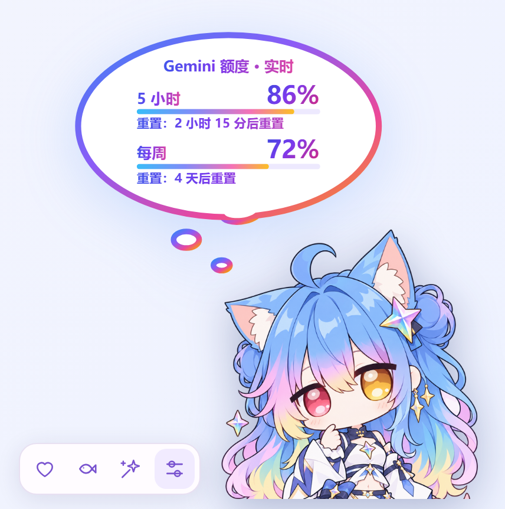
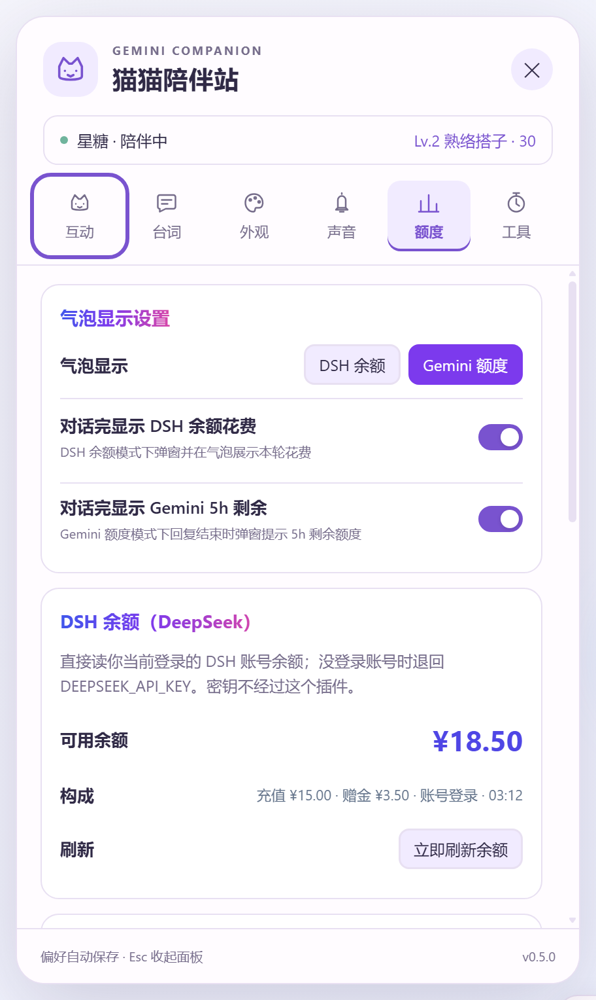
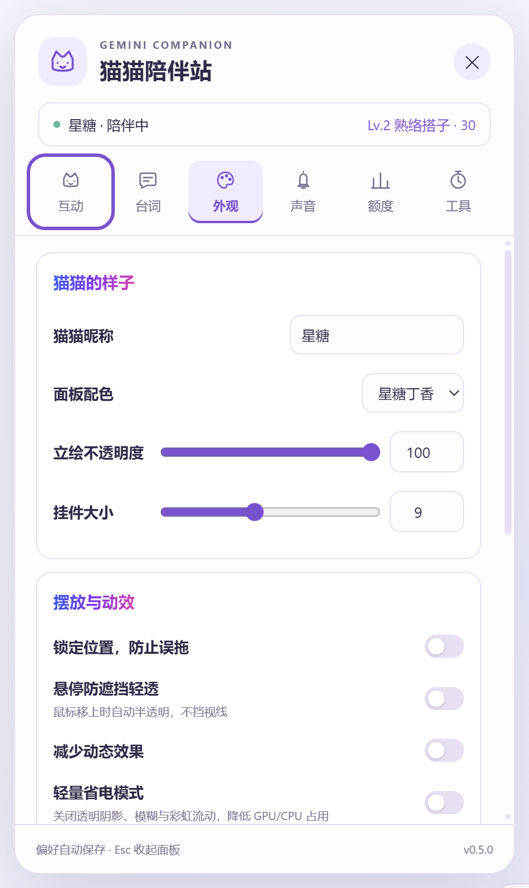
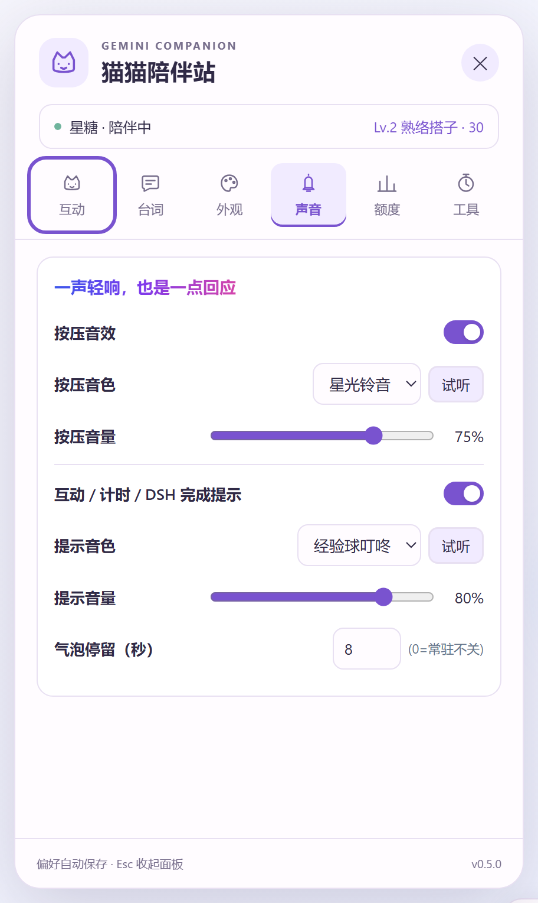
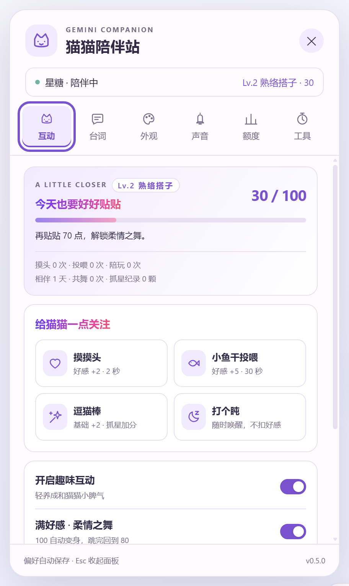

<h1 align="center">🐱 gemini-quota-widget-dsh</h1>

<p align="center">
  <b>DeepSeek Harness × 猫娘桌面挂件</b> — DSH 账户余额与花费追踪 · Gemini 多源额度同步 · 自定义立绘裁剪 · 趣味陪伴互动
</p>

<p align="center">
  
  
  
  
</p>

---

将 [gemini-quota-widget](https://github.com/smiththomson580-star/gemini-quota-widget) 移植并深度定制为 **DeepSeek Harness（DSH）插件**：在页面右下角常驻一只可拖拽、可互动的猫娘挂件，实时展示 **DSH 账户余额 / 轮次花费** 与 **Gemini 5 小时 / 每周剩余额度**，并支持 **10 MB 自定义立绘 1:1 裁剪管理**、**多音色完成提示（含和弦音）**、**番茄钟** 与 **好感度养成**。

<p align="center">
  
  &nbsp;&nbsp;
  
</p>
<p align="center">
  
  &nbsp;&nbsp;
  
  &nbsp;&nbsp;
  
</p>

---

## 🌟 核心亮点

### 1. 气泡双视图 & 轮次结束弹窗
- **双模式一键切换**（设置菜单 →「额度」→「气泡显示设置」）：
  - **DSH 余额**：优先读取当前登录的 DSH 账号可用余额与充值/赠金构成；未登录时自动回退到 `DEEPSEEK_API_KEY`（密钥仅由 DSH 凭据服务解析，不经过本插件）。
  - **Gemini 额度**：展示 5 小时滚动额度与每周剩余百分比、进度条及重置倒计时。
- **轮次结束提示开关**：
  - `对话完显示 DSH 余额花费`：DSH 余额模式下，每轮 AI 回复结束自动弹窗展示本轮花费与估算 Token / 剩余余额。
  - `对话完显示 Gemini 5h 剩余`：Gemini 额度模式下，每轮回复结束自动弹窗提示 5 小时剩余额度与重置时间。

### 2. 多源 Gemini 额度同步（agy / RT / OAuth）
- **agy 查询（默认主数据源）**：直接同步本地 `dsh-agy-link` 当前活跃账号的 5 小时与每周剩余额度。
- **其他查询方式（独立凭证，互不覆盖）**：
  - **RT 登录**：粘贴 Google Refresh Token（`1//...`）保存并查询独立账号额度。
  - **OAuth 登录**：支持浏览器一键 OAuth 登录授权并拉取额度。
  - 两种方式均可独立刷新查看，也可随时点击「设为主数据源」接管挂件气泡显示；需要切回时点击 `agy 查询` 处的「设为主数据源」即可。

### 3. 分级预警与主动提醒
- 在「额度」→「数据与预警」中可分别配置：
  - **Gemini 5h 预警（%）**
  - **Gemini 周预警（%）**
  - **DSH 余额预警（元）**（设为 `0` 关闭）
- 低于阈值时猫猫立绘旁自动亮起预警角标，并可开启「额度预警主动发言」弹窗提醒。

### 4. 本地自定义立绘下拉管理 & 1:1 裁剪器
- **10 MB 大图导入**：支持 `WebP` / `PNG` / `JPG`，单张上限提升至 **10 MB**。
- **内置 1:1 交互式裁剪**：导入时自动弹出裁剪窗（匹配猫猫展示比例），支持鼠标拖拽平移、滚轮/滑块缩放、居中重置与透明通道保留（也可选择「原图导入」）。
- **完整立绘库管理**：所有导入的立绘均存入「当前立绘」下拉菜单，支持随时切换、在线改名、重新裁剪、删除或一键切回「原版猫娘」。

### 5. 统一声音与气泡停留控制
- **按压音效**：独立开关与音色选择（`星光铃音` / `小黄鸭` / `Q弹气泡`）及按压音量调节。
- **互动 / 计时 / DSH 完成提示**：合并统一控制，内置 `经验球叮咚`、`清脆铃音 A`、`和弦音`（柔和四音大七和弦合成音色）与 `静音仅冒泡`，均支持即时「试听」。
- **全局生效**：上方「提示音量」与「气泡停留（秒）」（`0` 为常驻不关闭）同时对互动、番茄钟与 DSH 对话完成气泡生效。

### 6. 陪伴养成与外观自定义
- **5 阶段羁绊系统**：初见猫猫 → 熟络搭子 → 粘人小猫 → 偏爱唯一 → 心动满格；支持摸摸头、小鱼干投喂、逗猫棒抓星星、打盹与满好感柔情之舞。
- **台词与效率工具**：内置多风格台词、签到时段问候、专属台词本、猫猫番茄钟，以及陪伴偏好 JSON 一键导出/导入。
- **外观与防打扰**：支持 3 套主题配色（星糖丁香 / 奶油蜜桃 / 夜猫蓝紫）、挂件大小与不透明度调节、边缘吸附、位置锁定、悬停防遮挡轻透、轻量省电模式，以及老板键 `Alt + H`。

<p align="center">
  
</p>

---

## 📦 安装与使用

### 安装插件
1. 下载或克隆本仓库到本地目录（例如 `gemini-quota-widget-dsh`）。
2. 在 DeepSeek Harness（DSH）中安装该插件目录：
   ```text
   plugin_manager action=install_bundle target=<本目录绝对路径>
   ```
3. 安装后在 DSH 中按 `Ctrl + R` 刷新页面即可在右下角看到猫娘挂件。

### 快速上手
- **单击猫娘**：弹出实时余额/额度气泡并 Q 弹一下；**单击气泡框**可切换猫娘台词 / 再次点击关闭气泡。
- **右键猫娘或点击 `☰`**：打开设置菜单（含「互动」「台词」「外观」「声音」「额度」「工具」6 个标签页）。
- **拖拽菜单顶栏**：可在当前会话内自由移动设置面板位置；双击顶栏恢复默认位置。
- **老板键**：按 `Alt + H` 快速隐藏或唤回挂件。

---

## 🛠️ 项目结构与构建

```text
gemini-quota-widget-dsh/
├── assets/
│   └── gemini-widget.js    # 构建后的前端挂件产物
├── docs/
│   └── assets/             # README 展示截图
├── build/
│   ├── build-widget.mjs    # 上游源码补丁与 esbuild 打包脚本
│   ├── dsh-bridge.js       # 前端桥接层（余额/额度轮询、多数据源与视图控制）
│   └── verify.mjs          # 路由与注入验证脚本
├── lib/
│   └── index.js            # DSH 宿主路由（余额、agy-link 同步、RT / OAuth 查询）
├── cordis.patch.yml        # DSH 插件注入配置
├── package.json            # 插件清单
├── icon.png                # 插件图标
└── README.md
```

如需基于上游源码修改并重新生成 `assets/gemini-widget.js`：

```bash
node build/build-widget.mjs <上游 gemini-quota-widget-main 路径>
```

---

## 🙏 参考与致谢

- [gemini-quota-widget](https://github.com/smiththomson580-star/gemini-quota-widget) — 上游猫娘挂件与 companion 陪伴系统
- [dsh-agy-link](https://github.com/amlyczz/dsh-agy-link) — Antigravity 本地配额同步与 OAuth 思路参考
- [DeepSeek-Balance-Whale-Widget](https://github.com/MeteorNOX/DeepSeek-Balance-Whale-Widget) — DSH 余额读取交互参考

## 📄 许可

[MIT License](./LICENSE)
